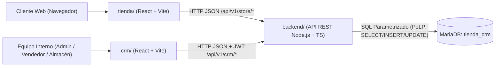
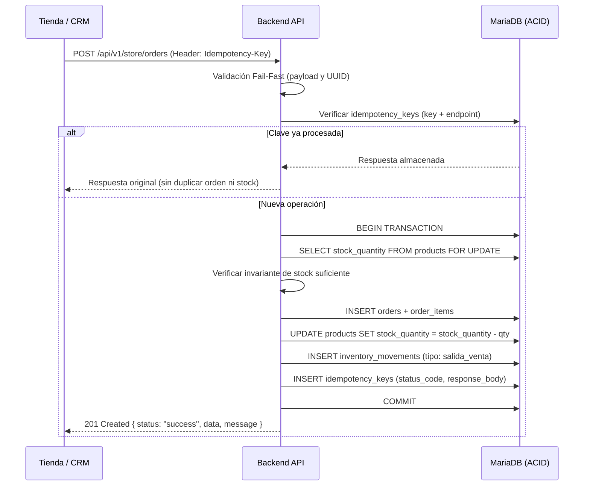

# Arquitectura del Sistema: Tienda Online + CRM

## 1. Visión General

El sistema se divide en tres aplicaciones desacopladas dentro de carpetas independientes, respaldadas por un motor relacional MariaDB:

- **`tienda/`**: Tienda online pública especializada en **refrigeración vehicular** (compresores A/C, condensadores, evaporadores, gases refrigerantes, aceites PAG/POE, válvulas de expansión, filtros deshidratadores) y **productos variados para vehículos** (iluminación LED, cuidado automotriz, accesorios de interior y exterior).
- **`crm/`**: Panel administrativo para el equipo interno donde se gestionan **ventas/pedidos**, **control de inventario (stock y kardex)**, **clientes** y el **carrusel de banners** que se muestra en la portada de la tienda.
- **`backend/`**: API REST stateless en Node.js + TypeScript que centraliza las reglas de negocio bajo **DDD (Domain-Driven Design)** y arquitectura **Hexagonal (Ports & Adapters)**.
- **`database/`**: Migraciones SQL y configuración de permisos de mínimo privilegio (PoLP) para **MariaDB**.

---

## 2. Bounded Contexts (DDD) en `backend/src/modules/`

Cada módulo de negocio se organiza en tres capas estrictas:
- `domain/`: Entidades, Value Objects inmutables, errores de dominio e interfaces (Ports) de repositorio. **Cero dependencias de frameworks ni SQL.**
- `application/`: Casos de uso (Use Cases / Services) y DTOs de entrada/salida. Orquesta transacciones e invariantes.
- `infrastructure/`: Adaptadores concretos (repositorios MariaDB con consultas preparadas, controladores HTTP, validadores de frontera y mapeadores).

| Módulo | Responsabilidad Principal | Consumidores |
| :--- | :--- | :--- |
| `health` | Probes `/health/live` (proceso vivo) y `/health/ready` (conectividad a MariaDB). | Infraestructura / Monitoreo |
| `auth` | Login, refresh tokens rotativos en DB, JWT stateless, RBAC (`admin`, `vendedor`, `almacen`, `cliente`). | `crm/`, `tienda/` |
| `catalog` | Categorías (jerárquicas o planas) y productos (refrigeración vehicular + accesorios, SKU, compatibilidad vehicular, precio, atributos técnicos). | `tienda/`, `crm/` |
| `banners` | Gestión de slides del carrusel principal (imagen, título, texto destacado, subtítulo, CTA, orden, vigencia por fechas, estado activo). | `crm/` (CRUD), `tienda/` (lectura pública) |
| `inventory` | Control de stock actual, stock mínimo, alertas de reposición y kardex de movimientos (`entrada`, `salida_venta`, `ajuste_positivo`, `ajuste_negativo`, `devolucion`). | `crm/`, módulo `sales` |
| `sales` | Creación idempotente de pedidos web y ventas en mostrador/CRM, transiciones de estado (`pendiente` -> `confirmado` -> `pagado` -> `despachado` -> `entregado` / `cancelado`), reserva/descuento atómico de inventario. | `tienda/`, `crm/` |
| `customers` | Directorio de clientes, datos fiscales/envío, historial de pedidos y notas de seguimiento comercial. | `crm/`, `tienda/` |

---

## 3. Flujo Crítico: Carrusel de Banners (CRM -> Tienda)

1. Un usuario con rol `admin` crea, edita, reordena o activa/desactiva un banner desde `crm/` mediante `/api/v1/crm/banners`.
2. `backend/` valida los datos en frontera (URL de imagen, fechas de vigencia `starts_at`/`ends_at`, orden `display_order`) y persiste el cambio en `banners`.
3. Al abrir la portada en `tienda/`, esta consulta `GET /api/v1/store/banners`.
4. El backend devuelve únicamente los banners con `is_active = 1`, `deleted_at IS NULL` y cuya fecha actual esté dentro de `[starts_at, ends_at]`, ordenados ascendentemente por `display_order`.

---

## 4. Flujo Crítico: Venta + Descuento de Inventario Idempotente

---

## 5. Principios de Seguridad y Resiliencia Aplicados

1. **Zero Trust & Deny by Default:** Todas las rutas `/api/v1/crm/*` exigen JWT válido y autorización explícita por rol. Las rutas públicas se limitan a lectura de catálogo/categorías/banners y creación de órdenes de cliente.
2. **Principle of Least Privilege (PoLP):** La API se conecta a MariaDB con `tienda_crm_app`, usuario restringido únicamente a `SELECT, INSERT, UPDATE` sobre `tienda_crm.*` (sin `DROP`, `ALTER`, `DELETE` físico ni acceso a otros esquemas).
3. **Defense in Depth:** Proxy/rate-limit -> Cabeceras seguras (HSTS, CSP, `X-Content-Type-Options`) -> Validación tipada de entrada -> Consultas preparadas parametrizadas -> Transacciones ACID y restricciones `CHECK`/`FK` en DB.
4. **Database as Storage, not Business Logic:** Toda la lógica de validación de estados, cálculos de totales y reglas de descuento vive en TypeScript dentro de `backend/src/modules/*/domain` y `application`.
5. **Observabilidad:** Cada petición recibe un `X-Request-Id` que viaja en todos los logs JSON estructurados y se devuelve en cabecera de respuesta para correlación.
